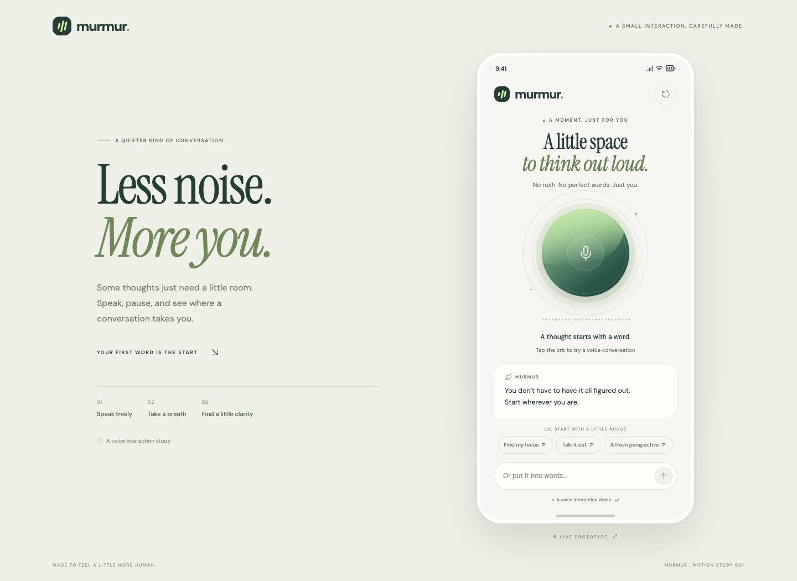

# Murmur

A small, polished Expo screen about giving a thought a little room. Tap the living microphone orb, watch words unfold, pause with the thinking indicator, and receive a softly animated reply.

This is a **scripted interaction demo**. It does not record audio, call an AI service, or store messages. The same React Native screen runs on iOS, Android, and web; the desktop web layout frames it as a live prototype.



[Shareable GIF](https://raw.githubusercontent.com/Blaze5333/murmur-expo/main/public/demo/murmur-demo.gif) · [Watch the 13-second screen capture](public/demo/murmur-demo.mp4) · [Looping GIF](public/demo/murmur-demo.gif) · [Mobile screenshot](public/demo/murmur-idle.png)

## Run with Bun

```sh
bun install --frozen-lockfile
bun run start       # Expo Go / development build
bun run web         # interactive browser preview
bun run android
bun run ios
```

Use a version of Expo Go compatible with SDK 58. The iOS simulator command requires Xcode. No environment variables or API keys are needed.

## Verify, build, and record

```sh
bun run check
bun run build:web
bun run test:e2e
bun run record
bun run preview    # http://127.0.0.1:4173
```

The browser checks and capture script use installed Google Chrome. Set `CHROME_PATH` in the capture script environment if Chrome is elsewhere. The recording script writes a portrait MP4, a GIF, and preview PNGs to `public/demo/`. Run `bun run build:web` again after recording to include them in `dist/`.

## Share on Vercel

Import this repository into Vercel. `vercel.json` already configures Bun, the Expo web export, and `dist/`. Or, while logged in to Vercel:

```sh
bunx vercel --prod
```

The deployed `/` is interactive. `/demo/murmur-demo.mp4` and `/demo/murmur-demo.gif` are direct screen-capture links suitable for the application field. See `PROJECT_OVERVIEW.md` for implementation context, motion details, and the latest validation and publishing status.

## Current verification

Type checking and lint pass, all 8 browser interaction checks pass, and both iOS and Android Hermes bundle exports pass. Native device execution has not been checked. The MP4/GIF are committed and shareable; a working interactive public deployment requires Vercel login or resolution of the GitHub account’s Pages/Actions billing lock. See `SUBMISSION.md` for the verified submission links.
